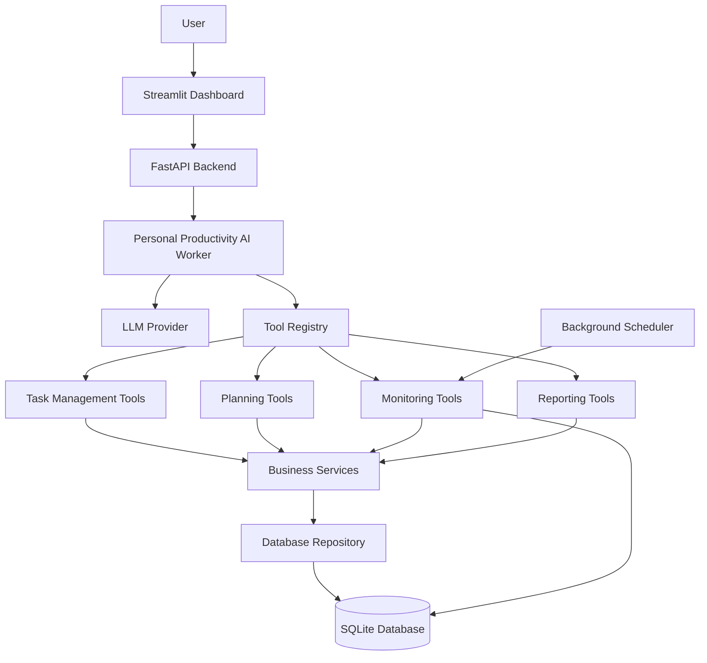
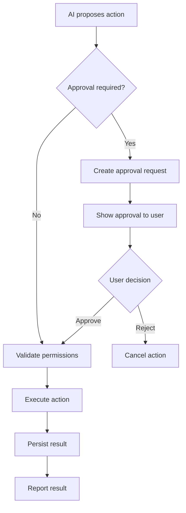

# System Architecture — AI Personal Task Manager

## 1. Architecture Overview

The AI Personal Task Manager will use a modular architecture built around a single AI Worker with multiple specialized tools.

The system will separate:

- User interface.
- API and application logic.
- AI orchestration.
- Tool execution.
- Business logic.
- Database operations.
- Scheduling and monitoring.

The architecture should be simple enough for a beginner to understand while remaining extensible for future development.

## 2. High-Level Architecture



## 3. Technology Stack

| Technology | Responsibility |
|---|---|
| Python | Main programming language |
| OpenAI Agents SDK | AI agent orchestration and tool calling |
| OpenRouter | LLM provider through a compatible API |
| Pydantic | Input and output validation |
| FastAPI | Backend API |
| SQLAlchemy | Database interaction |
| SQLite | Persistent storage |
| Streamlit | Initial user interface |
| APScheduler | Background scheduling and deadline monitoring |
| Pytest | Automated testing |
| MCP | Future external application integrations |
| LangGraph | Future advanced workflow orchestration |

Dependencies should be introduced only when required. The MVP should avoid unnecessary complexity.

## 4. Main Components

### 4.1 User Interface

Location: `app/ui/`

Responsibilities:

- Display dashboard.
- Accept user messages.
- Display AI responses.
- Display task lists.
- Show daily plans.
- Display approval requests.
- Show productivity reports.

The UI must not directly modify database records.

All operations should go through the backend application layer.

### 4.2 FastAPI Backend

Location: `app/api/`

Responsibilities:

- Receive HTTP requests.
- Validate request data.
- Authenticate users when authentication is introduced.
- Call the AI Worker.
- Return structured responses.
- Handle application errors.

The API layer should not contain AI reasoning or database business logic.

### 4.3 AI Worker

Location: `app/worker/`

The Personal Productivity AI Worker is responsible for understanding user requests and coordinating authorized tools.

Responsibilities:

- Interpret natural language.
- Understand the current context.
- Select appropriate tools.
- Request structured information when needed.
- Execute multi-step workflows.
- Handle tool errors.
- Report operation results.

The worker should use a controlled agent execution loop.

It must not directly execute arbitrary SQL, filesystem operations, shell commands, or unrestricted Python code.

### 4.4 Tool Registry

Location: `app/tools/`

The tool registry exposes authorized application capabilities to the AI Worker.

Tools will be grouped into modules.

**Task Management Tools**

- create_task
- update_task
- delete_task
- get_tasks
- complete_task
- search_tasks

**Planning Tools**

- prioritize_tasks
- break_down_task
- generate_daily_plan

**Monitoring Tools**

- check_deadlines
- identify_overdue_tasks

**Reporting Tools**

- generate_daily_report
- generate_weekly_report

Each tool must:

- Accept validated arguments.
- Enforce permission checks.
- Call application services.
- Return structured results.
- Handle expected failures.
- Avoid exposing sensitive internal information.

### 4.5 Business Services

Location: `app/services/`

Services contain deterministic application logic.

Examples:

**Task Service**
- Create and update tasks.
- Validate task status transitions.
- Manage task dependencies.
- Enforce deletion rules.

**Planning Service**
- Calculate available working time.
- Evaluate task urgency.
- Identify schedule conflicts.
- Build proposed schedules.

**Monitoring Service**
- Find approaching deadlines.
- Identify overdue tasks.
- Generate monitoring events.

**Reporting Service**
- Calculate completed tasks.
- Summarize pending tasks.
- Generate productivity statistics.

The LLM may recommend priorities, but deterministic code must validate dates, schedule constraints, and task state.

### 4.6 Database Layer

Location: `app/database/`

SQLite will be the initial database.

SQLAlchemy will manage database interactions.

The database will contain the following initial entities:

**Tasks**

- id
- title
- description
- priority
- status
- category
- due_date
- estimated_duration
- created_at
- updated_at
- completed_at

**Subtasks**

- id
- parent_task_id
- title
- status
- position
- created_at
- completed_at

**User Preferences**

- id
- preference_key
- preference_value
- updated_at

**Conversation History**

- id
- conversation_id
- role
- content
- created_at

**Daily Plans**

- id
- plan_date
- plan_data
- status
- created_at
- updated_at

**Approval Requests**

- id
- action_type
- action_payload
- status
- created_at
- resolved_at

Database relationships, constraints, indexes, and migrations must be implemented and tested.

Task and approval records must be persisted reliably.

## 5. AI Worker Execution Flow

The standard request lifecycle:

1. User submits a request.
2. FastAPI validates the request.
3. The AI Worker receives the request and relevant context.
4. The LLM interprets the user's intent.
5. The LLM selects an authorized tool when required.
6. The tool validates its input.
7. The application checks permissions.
8. The service performs the requested operation.
9. The repository persists the result.
10. The tool returns a structured result.
11. The AI Worker interprets the result.
12. The final response is returned to the user.

For multi-step requests, the worker may repeat the tool-selection and execution process within a configured maximum number of iterations.

A failed tool operation must never be reported as successful.

## 6. Human Approval Architecture

Some operations require explicit user approval.

Examples:

- Deleting tasks.
- Replacing an approved daily plan.
- Sending external notifications.
- Modifying external calendar events.

Approval workflow:



Approval must be enforced by backend code, not just AI instructions.

Approved actions should be bound to their exact action payload. Changes to that payload require a new approval.

Approval requests must support expiration and rejection.

## 7. Memory and Context Architecture

The application will distinguish between three types of information.

**Conversation Context**

- Recent messages.
- Current user request.
- Tool execution results.

**Persistent User Memory**

- Preferred working hours.
- Preferred task categories.
- Productivity preferences.
- Relevant user-defined settings.

**Operational State**

- Existing tasks.
- Task statuses.
- Deadlines.
- Approved plans.
- Pending approval requests.

Operational state must come from the database rather than relying on the LLM's conversation memory.

## 8. Scheduling and Background Monitoring

APScheduler will be considered for recurring background operations.

Responsibilities:

- Check upcoming deadlines.
- Identify overdue tasks.
- Generate scheduled summaries.
- Trigger reminder events.

Background jobs must be idempotent where possible.

The system should avoid duplicate reminders and duplicate task modifications.

The MVP can begin with manually triggered deadline checks before background scheduling is introduced.

## 9. Security Architecture

Security is a core requirement.

### Input Validation

- Validate every tool argument.
- Use Pydantic schemas.
- Enforce maximum input lengths.
- Reject invalid dates and unsupported values.

### Tool Permissions

- Use an explicit tool allowlist.
- Enforce authorization in application code.
- Apply least-privilege access.
- Require approval for sensitive actions.

### Prompt Injection Protection

Task descriptions, imported documents, emails, and other external content must be treated as untrusted data.

The AI must not treat instructions embedded in those sources as trusted system instructions.

### Database Security

- Use parameterized queries through SQLAlchemy.
- Enforce database constraints.
- Validate state transitions.
- Maintain reliable transaction boundaries.
- Avoid exposing database credentials.

### Secrets

- Store API keys in environment variables.
- Never commit `.env` files.
- Provide `.env.example` without real credentials.

### Auditability

Record important operations:

- Action requested.
- Tool invoked.
- Approval status.
- Execution result.
- Timestamp.

Never store unnecessary secrets in logs.

## 10. Error Handling and Reliability

The application must handle:

- LLM provider failures.
- Invalid model responses.
- Tool execution errors.
- Database failures.
- Network failures.
- Invalid task data.
- Expired approval requests.
- Background scheduler failures.

Important operations must use transactions where appropriate.

The system must not repeat non-idempotent actions blindly after timeouts.

Errors should be logged safely and presented to the user in understandable language.

## 11. Testing Strategy

Use Pytest.

**Unit Tests**
- Task validation.
- Priority calculations.
- Date calculations.
- Business service logic.
- Permission checks.

**Tool Tests**
- Tool arguments.
- Successful execution.
- Invalid input.
- Unauthorized operations.
- Database failures.

**Agent Tests**
- Correct tool selection.
- Multi-step workflows.
- Tool error handling.
- Maximum execution limits.
- Accurate final responses.

**Integration Tests**
- API and database.
- AI Worker and tools.
- Approval workflow.
- Background monitoring.

Use mock LLM responses for deterministic automated tests. Live LLM tests should be separate and explicitly enabled.

## 12. Project Folder Structure

```text
ai-personal-task-manager/
│
├── app/
│   ├── main.py
│   │
│   ├── worker/
│   │   ├── agent.py
│   │   ├── instructions.py
│   │   ├── context.py
│   │   └── execution.py
│   │
│   ├── tools/
│   │   ├── task_tools.py
│   │   ├── planning_tools.py
│   │   ├── monitoring_tools.py
│   │   └── reporting_tools.py
│   │
│   ├── services/
│   │   ├── task_service.py
│   │   ├── planning_service.py
│   │   ├── monitoring_service.py
│   │   └── reporting_service.py
│   │
│   ├── database/
│   │   ├── database.py
│   │   ├── models.py
│   │   ├── repository.py
│   │   └── migrations/
│   │
│   ├── schemas/
│   │   ├── task.py
│   │   ├── planning.py
│   │   └── approval.py
│   │
│   ├── api/
│   │   └── routes.py
│   │
│   ├── ui/
│   │   └── dashboard.py
│   │
│   └── scheduler/
│       └── jobs.py
│
├── tests/
│   ├── unit/
│   ├── tools/
│   ├── agent/
│   └── integration/
│
├── docs/
│   ├── PRODUCT_VISION.md
│   ├── ARCHITECTURE.md
│   └── AGENTS.md
│
├── .env.example
├── .gitignore
├── requirements.txt
└── README.md
```

This structure is a target architecture. Components should be introduced incrementally rather than creating empty modules for every future feature.

## 13. Development Principles

1. Build one working feature at a time.
2. Keep business logic separate from LLM reasoning.
3. Use tools for real operations.
4. Validate every AI-generated argument.
5. Keep operational state in the database.
6. Make important operations observable.
7. Require human approval for sensitive actions.
8. Test failures as carefully as successful operations.
9. Avoid unnecessary abstractions and dependencies.
10. Expand the architecture only when a real requirement justifies it.

## 14. Future Extensibility

The architecture should allow future integration with:

- Google Calendar.
- Gmail.
- WhatsApp notifications.
- MCP servers.
- External task-management services.
- Voice interfaces.
- LangGraph workflows.
- Additional specialized agents.

These integrations must use explicit permissions and secure authentication.

## 15. Architecture Decision

The first release will use:

**One AI Worker + Multiple Tools + Deterministic Services + SQLite.**

We will not begin with multi-agent orchestration or complex autonomous workflows.

The goal is to understand and build a reliable AI Worker before increasing its autonomy or complexity.